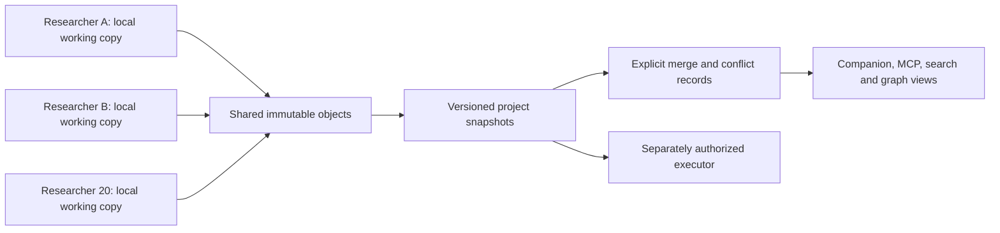

# Portable research storage

Design, 2026-10-20; based on source `a4c349f` and published Paperhands 0.4.0.
This is the next storage contract, not an implemented S3/R2 backend. The executable
still uses the local v1 store. No bucket or cloud account was changed for this design.

Paperhands should keep one logical research project across many machines: shared
evidence, private working copies, explicit competing interpretations. Use immutable
content-addressed objects, revision and snapshot DAGs, conditional branch heads,
and rebuildable local indexes. The same format belongs on disk, S3 and R2.



## Why directory sync is insufficient

Current mechanisms are useful locally but cannot become distributed coordination:

| Source at `a4c349f` | Mechanism and consequence |
| --- | --- |
| `src/project.rs:12` | Schema 1 binds a project to one local storage path. |
| `src/memory.rs:14`, `:269` | Text, receipt time and prepared embeddings share one hashed JSON object. Identical text recorded twice need not deduplicate. |
| `src/memory.rs:128`, `:191` | Filesystem lock; full scan capped at 1,024 notes. |
| `src/tasks.rs:90` | Per-task sequential filenames and one previous hash. Two offline edits can occupy the same filename. |
| `src/graph.rs:89`, `:413` | Collection locks; no cross-collection snapshot transaction. |
| `src/research/plan.rs:213` | Local directory reservation and rename; absolute execution paths belong to the originating machine. |
| `src/research/inventory.rs:189` | Flat retained-tree walk capped at 100,000 members. |

Consumer feedback also exposed a smaller limit: 640 notes expanded into 6,956
prepared passages, exceeding the combined search index's 4,096-document bound.
`src/memory.rs:300` combines them; `src/companion.rs:118` does not propagate that
retrieval failure into desk gaps. The report's counts are consumer-supplied; the
two source mechanisms were inspected here. This needs a separate v1 compatibility
fix and must not be mistaken for an empty archive.

Raising these caps or uploading a live SQLite database would leave the identity,
concurrency and partial-publication problems intact.

## Identities that survive a move

- **Project ID:** stable across replicas. Different projects can share a bucket,
  but stay separate namespaces. A federation view pins their individual snapshots.
  Importing another project retains its origin; it does not rewrite its identities.
- **Replica ID:** freshly generated for a new working copy, outside the portable
  project config. A fork must not inherit the source's writer state.
- **Writer ID:** fresh random identity for a writer session, bound to an
  authenticated principal where available. An ID alone proves no authorship.
- **Entity ID:** `project_id/origin_replica_id/random_id`. Short names such as
  `policy-000` are aliases. Ambiguous aliases require explicit selection.
- **Object ID:** `sha256:<64 lowercase hex digits>`, over exact stored bytes.
  Provider ETags are opaque concurrency tokens, never content identities.
- **Operation ID:** persisted before a mutation. Retrying the same writer/operation
  with identical bytes is idempotent; different bytes are an integrity conflict.
  Network retries never reserve another experiment attempt.

These identities distinguish one receipt copied 20 times, 20 receipts of one blob,
and 20 independent observations. They are different counts. Economic case/event
identities and reused-liquidity assumptions remain explicit supplied evidence.

## Object and snapshot format

Remote layout, scoped to one tenant/project access boundary:

```text
<prefix>/projects/<project_id>/v2/
  objects/sha256/ab/<full_digest>   # blobs AND typed metadata
  refs/writers/<writer_id>         # conditional mutable pointer
  refs/branches/<branch>           # conditional mutable pointer
```

Local working state is separate: object cache, materialized inputs, index database,
pending uploads and local execution controls. Never replicate lockfiles, open WAL
files, credentials or PIDs as instructions for a new machine. Original path/PID/
argv receipts remain historical evidence with their original privacy classification.

Store raw text, captures and output bytes once. A separate receipt records source
identity, source/venue time, local receipt time, data-use label, closure evidence
and interpretation. A file tree maps validated relative paths to blob IDs, byte
lengths and whole-file hashes. Unknown source time stays null. Retain invalid
intervals, failed raw responses and every partial or unpriced holding.
External provenance dependencies must be pinned and imported, or declared as
unbundled gaps. A manifest containing external paths is not a portable closed bundle.

Typed metadata is UTF-8 JSON with a versioned schema; reject duplicate keys,
nonfinite numbers and invalid references. Hash original bytes, without a parse/
reserialize step. A deterministic writer helps reuse, but semantically equivalent
JSON need not have the same ID. Monetary quantities use exact decimal strings with
units. No custom JSON canonicalization or provider checksum convention is assumed.

A revision names an entity, its causal parents, a payload and provenance:

```json
{
  "schema": "paperhands.revision/v2",
  "project_id": "PROJECT",
  "entity_id": "PROJECT/ORIGIN/ENTITY",
  "kind": "task",
  "parents": ["sha256:PARENT"],
  "writer_id": "WRITER",
  "operation_id": "OPERATION",
  "payload": "sha256:PAYLOAD",
  "provenance": ["sha256:SOURCE_RECEIPT"],
  "recorded_at_ms": 1792530000000
}
```

The uppercase identifiers in examples are placeholders. Schemas enumerate all
reference-bearing fields; arbitrary strings are not inferred to be object links.
Parents belong to the same entity/project. Origins and evidence records are
immutable; changing a task decision or source interpretation creates a revision.
Changing frozen code, data, evaluator or accounting creates a new experiment
question/attempt, never an edit to its existing evidence.

A snapshot commit contains `schema`, `project_id`, `parents`, `writer_id`,
`operation_id`, `recorded_at_ms` and `roots`. Its parents are previous commit IDs;
its roots identify immutable Merkle manifests for entities, receipts, datasets,
attempts, relations, reviews and conflicts. Each entity entry retains its revision
heads. Pages declare their schema, bounded members, counts and child references;
hash-prefix partitioning allows incremental union without a whole-project scan.
All referenced objects must exist and verify before publication. Unknown required
schemas prevent activation; an importer may retain them opaquely with an explicit gap.

The commit is the read boundary: the desk, MCP, graphs and searches pin it for the
entire request. A mutable ref contains `{schema, project_id, generation, commit}`.
Generation increases on every successful update; refs cannot be rewound or deleted
by normal writers. There is no timestamp-based global order across machines.

## Publish without partial projects or lost writers

1. Pin the destination ref and its ETag. Persist operation bytes and dependencies.
2. Upload missing objects with create-only semantics. If a key already exists,
   verify its byte identity; mismatched content is corruption, never an overwrite.
3. Verify the new commit's reference closure against the destination. Incremental
   verification may reuse verified immutable subtrees; a deep audit checks all bytes.
4. Create the commit object, then update exactly one ref with `If-Match` on the
   ETag read in step 1. An initial ref uses `If-None-Match: *`.
5. On a precondition failure, read the new head, construct a merge and retry within
   a bounded budget. Keep the local branch when that budget is exhausted.

Each writer can publish a private branch; merging them into a project branch is a
separate operation. A single project branch may serialize commits without serializing
experiments. If contention becomes measurable, retain more branches and merge less
often. Do not invent a distributed lock around every note.

An interrupted upload leaves unreachable objects and the previous head usable.
An ambiguous write response remains unknown: reconcile the exact operation/head,
and retry conditionally with the same bytes. One negative read does not cancel an
in-flight write. No automatic ref reset or deletion occurs during reconciliation.
Use authenticated object APIs for refs; cached public URLs cannot be authoritative.

AWS documents conditional creation/update, and single-key atomicity without
multi-key transactions. R2 documents atomic conditional writes and strong object
consistency. Those properties support this publication protocol; they do not create
a transaction across multiple objects. Backend adapters must pass a conformance
probe rather than assuming every S3-compatible service behaves identically.
[S3 conditional writes](https://docs.aws.amazon.com/AmazonS3/latest/userguide/conditional-writes.html),
[S3 consistency](https://docs.aws.amazon.com/AmazonS3/latest/userguide/Welcome.html#ConsistencyModel),
[R2 consistency](https://developers.cloudflare.com/r2/reference/consistency/).

## Merge facts; resolve decisions

The retained fact set merges by verified union: associative, commutative and
idempotent. Snapshot histories may differ by merge order; their projected fact
sets and conflicts must agree. A multi-parent commit records which snapshots joined.

| Situation | Result |
| --- | --- |
| Same object or original receipt in several replicas | One retained identity, all original provenance. |
| Distinct receipts for identical bytes | Shared blob, distinct receipts; no claim of independent evidence. |
| Same short attempt name, different origins | Separate attempts; alias collision visible. |
| One revision causally descends from another | Descendant is the current head; both remain in history. |
| Concurrent task states, briefs, directions or reviews | Multiple heads and a conflict; no silent last-writer or best-score choice. |
| Resolution | New revision names every head it resolves, records actor/reason and selected payload. A later unseen head reopens the conflict. |
| Source/evaluator/accounting changed | Separate pinned evidence; comparison needs an explicit new contract. |
| Unknown, failed or partial result | Preserved; merging changes neither validity nor disposition. |
| Imported legacy output | Receipt says imported; it never fabricates local process success. |

Two individually valid DAGs can form a cycle when joined. Keep all relation claims;
compute strongly connected components in each constrained DAG projection. Quarantine
the internal edges of cyclic components from the accepted projection and record the
conflict. Affected tasks and their dependents cannot be ready until an explicit
resolution supersedes claims. Do not drop whichever edge arrived last. Other
unaffected research remains usable. Revision ancestry itself must always be a DAG.

Retirement, correction and retraction are new records with reasons/revisit conditions;
they do not erase raw evidence. Similarity, declared attention and review authority
remain separate fields. A newer timestamp is neither a better hypothesis nor permission.

## Scale by sharing inputs and rebuilding views

Use paged Merkle manifests for collections and file trees. Large files can use a
versioned ordered chunk manifest, with lengths, per-chunk IDs and a verified whole-
file digest. Preserve the exact original byte stream on reconstruction. Multipart
upload is a transport detail, not a file identity or evidence boundary.

Keep local SQLite catalogs/search projections disposable and snapshot-bound.
Pocket Encoder segments cite exact source objects and byte spans, model/tokenizer/
preprocessing hashes and dimensions. Embeddings and clusters are derived objects;
they can be shared or rebuilt, and never replace original text/provenance. A query
reports the selected snapshot, indexed snapshot, coverage, filters and paging cursor.
A partial/offline cache cannot answer “nothing exists” as though coverage were complete.
Track metadata completeness, blob availability and verified search coverage
separately. Missing historical input stays unknown; never repair it from today's API.

Derived columnar tables can later serve large parameter sweeps and frontend charts.
They cite input roots, evaluator/accounting and transformation versions. Add packed
object segments or an analytical catalog only when request/scan measurements justify
them. A data lake is not required to merge the first 20 researchers.

A 200-policy sweep references one immutable data/evaluator snapshot and separate
policy/attempt/result manifests. Store shared bytes once, keep all result identities,
and report overlap/event concentration. Reused hypothetical liquidity cannot be
summed into a funded portfolio. Budget transferred bytes, requests, cache/output
growth, retries, concurrency and total wall time; publish measured rates, not a
hardcoded claim that 20 writers or 200 policies are always safe.

## Access, retention and operating authority

Scope deduplication to the tenant/project access boundary. Sharing a physical
bucket does not grant cross-project reads. IAM or a gateway enforces access;
stored actor strings and hashes do not prove authenticity. Use separate reader,
append-writer and ref-publisher permissions where the backend permits it. A central
gateway can validate closure/identity/signatures before publishing shared refs;
untrusted clients must not have unrestricted write access to those refs.

Credentials belong in external profiles/secret storage. Local `paperhands.toml`
keeps stable project identity; a future local storage profile chooses endpoint,
bucket, prefix, region and credential reference. Initial encryption uses TLS and
configured provider encryption. Client-side encryption needs its own versioned
envelope/key-rotation contract; plaintext hash names are not encryption.

Versioning, retention holds and immutable audit copies are backend capabilities to
verify explicitly. R2 implements an S3 subset, including differences in checksum
and Object Lock support; provider ETags/checksums cannot define this format.
[R2 S3 compatibility](https://developers.cloudflare.com/r2/api/s3/api/).
Record configured and verified capabilities, access changes, backup age and restore
checks. No generic “enterprise compliant” flag substitutes for those controls.

The first sync implementation has **no automatic deletion or garbage collection**.
Future reviewed retention must protect pinned snapshots, offline branches, failed
attempts, legal holds and external references. A tombstone in a projection is not
permission to delete bytes. Independent backups and restore verification remain
necessary even when primary storage is strongly consistent.

Merging storage never adopts a remote PID, executes a queued task, resumes a spent
attempt or joins account capital. A distributed scheduler needs an authoritative
claim/budget service, fencing and idempotent effect handling. Lease expiry cannot
stop an old worker; stale results remain retained and labeled. That is a separate
implementation from replication. Initial cloud storage supports research sync and
inspection while the existing bounded executor retains local ownership.

## Lossless transition from v1

1. Read-only dry-run inventories the original store, reports every included/excluded
   path and its policy, collisions, sizes and unsupported members. Keep originals.
2. Retain original sealed manifests/plans/raw outputs as exact blobs. Import large
   archives incrementally; do not force a 121,030-file corpus into one v1 inventory.
3. Build an immutable mapping from old store/origin IDs and content hashes to new
   identities. Reimporting the same mapping is idempotent. Equal display names or
   text alone cannot establish that two legacy attempts are the same origin.
4. Register legacy datasets/results as imported evidence with provenance and explicit
   process-status gaps. Derive exact cited source partitions without losing full
   originals. Do not manufacture an experiment run to make an old result searchable.
5. Preserve absolute argv/path receipts privately; create separate local execution
   bindings for future attempts. Never rewrite the bytes under an old published hash.
6. Verify closure, counts and byte hashes before switching a project ref. Keep v1
   inspection available until migration and restore acceptance pass.

Replication into a private project is distinct from public export. Exclude secrets,
correspondence and harness sessions by explicit import policy. Existing public
allowlist export stays a separate operation; a bucket URL is not sanitization.

## Optional Ontology snapshot adapter

Read-only source inspection at Ontology `36b43b57268e19ed9b282fd5a6abaa89c2a69adc`
confirms `ImportedDataset` (`src/model.rs:116`), `Package::build_with_assets`
(`src/assets.rs:143`), `search_with_vector` (`src/lib.rs:367`) and scoped runtime
dispatch (`src/runtime.rs:462`). These could package a pinned Paperhands snapshot;
they do not supply a shipped live-store API or change Paperhands 0.5 storage.

Retain full original objects as binary assets; searchable documents are explicitly
derived views with source digests, byte spans and transformation/model provenance.
The builder can append image references to document text (`src/assets.rs:156`), so
searchable text alone cannot establish original-byte preservation. Map exact
revision IDs into provenance nodes and relations. `Node::entity` hashes supplied
bytes; this establishes a local byte receipt, not venue truth or producer authority.
`Lineage::merge` (`src/provenance/lineage.rs:101`) is not Paperhands' concurrent
revision/conflict resolver; preserve separate revision IDs and all unresolved heads.

The proposed future `open/append/view/search/seal` boundary is compatible if a
SQLite journal remains local and derived indexes are snapshot-bound. A sequence
orders one replica's receipts; cross-replica identity/order uses immutable commit
hashes and causal parents. `expected_head` must compare an exact commit identity.
Append needs a durable operation ID for ambiguous-response reconciliation; sealing
verifies transitive reference closure before publishing. Similarity groups retain
scope, model, bounds and member citations separately from source-backed relations.
No Ontology live implementation, adapter dependency or v1 migration is introduced
by this proposal. Paperhands retains its evidence, task and execution contracts.

## Implementation boundary and acceptance

Build in this order: local v2 object/revision/snapshot engine and lossless importer;
offline clone/merge with conflicts; S3/R2 adapters plus resumable bounded sync;
snapshot-bound MCP/search/desk; then distributed execution only under its own brief.
Proposed CLI families are `storage status|verify|push|pull`, `merge plan|apply|resolve`
and explicit federation queries. No such commands are present in 0.4.0.

The offline reference model is runnable without dependencies:

```sh
python3 -B design/storage_v2_model.py
```

It checks exact-byte dedup/tamper detection, immediate object links and causal
revision-parent closure, strict typed JSON, origin collisions,
revision conflicts/resolution, operation reuse, DAG union cycles, project isolation,
20-writer convergence and stale conditional-head rejection. Its flat in-memory sets
and simulated CAS are a design fixture, not a backend, scalable index, authentication
system or concurrency test of S3/R2. No cloud credentials or network calls are used.
Provenance objects in this tiny model are opaque blobs: it does not walk typed
manifest children, paged trees or unknown required schemas transitively. A valid
hash for a provenance manifest alone cannot establish that its children exist.
Production publication must verify that schema-driven transitive closure and leave
the head unchanged on a deep missing/corrupt child. Invalid legacy JSON remains
retained as original opaque bytes; duplicate keys/nonfinite values cannot activate
through the model's typed parser.

Production acceptance additionally requires fresh local/S3/R2 conformance: concurrent
conditional writes; dropped acknowledgments and multipart interruption; bad/missing
objects; paginated/sharded trees above 100,000 files; notes above 1,024; offline
replicas and stale caches; unsupported schemas and path/symlink refusal; full restore;
access denial and retention configuration. Run 20 replicas joining in different orders
with shared inputs, conflicting tasks and partial results. Account for every member,
preserve existing hashes, and measure wall/CPU/memory/network/request/storage growth.
None of those cloud or large-corpus checks is established by the small model.
